## Pertama buka
https://inventory.rinjaniproject.my.id
https://inventory.rinjaniproject.my.id/e-inventory/supplier/login/login.php
https://inventory.rinjaniproject.my.id/e-inventory/supplier/login/register.php

## User(Supplier)
https://inventory.rinjaniproject.my.id/e-inventory/supplier/
https://inventory.rinjaniproject.my.id/e-inventory/supplier/#hero
https://inventory.rinjaniproject.my.id/e-inventory/supplier/#ringkasan
https://inventory.rinjaniproject.my.id/e-inventory/supplier/#harga
https://inventory.rinjaniproject.my.id/e-inventory/supplier/#riwayat-po
https://inventory.rinjaniproject.my.id/e-inventory/supplier/login/logout.
https://inventory.rinjaniproject.my.id/#harga
https://inventory.rinjaniproject.my.id/#riwayat-po

https://inventory.rinjaniproject.my.id/e-inventory/supplier/#riwayat-po
https://inventory.rinjaniproject.my.id/e-inventory/supplier/?status=diajukan#riwayat-po
https://inventory.rinjaniproject.my.id/e-inventory/supplier/?status=disetujui#riwayat-po
https://inventory.rinjaniproject.my.id/e-inventory/supplier/?status=ditolak#riwayat-po
https://inventory.rinjaniproject.my.id/e-inventory/supplier/?status=selesai#riwayat-po

## Petugas
https://inventory.rinjaniproject.my.id/e-inventory/petugas

https://inventory.rinjaniproject.my.id/e-inventory/petugas/index.php
https://inventory.rinjaniproject.my.id/e-inventory/petugas/index.php?page=dashboard
https://inventory.rinjaniproject.my.id/e-inventory/petugas/index.php?page=barang-masuk
https://inventory.rinjaniproject.my.id/e-inventory/petugas/index.php?page=barang-keluar
https://inventory.rinjaniproject.my.id/e-inventory/petugas/index.php?page=stok
https://inventory.rinjaniproject.my.id/e-inventory/petugas/index.php?page=kebutuhan-bahan-baku
https://inventory.rinjaniproject.my.id/e-inventory/petugas/index.php?page=akun
https://inventory.rinjaniproject.my.id/e-inventory/petugas/login/logout.php

### A. https://inventory.rinjaniproject.my.id/e-inventory/petugas/index.php?page=dashboard
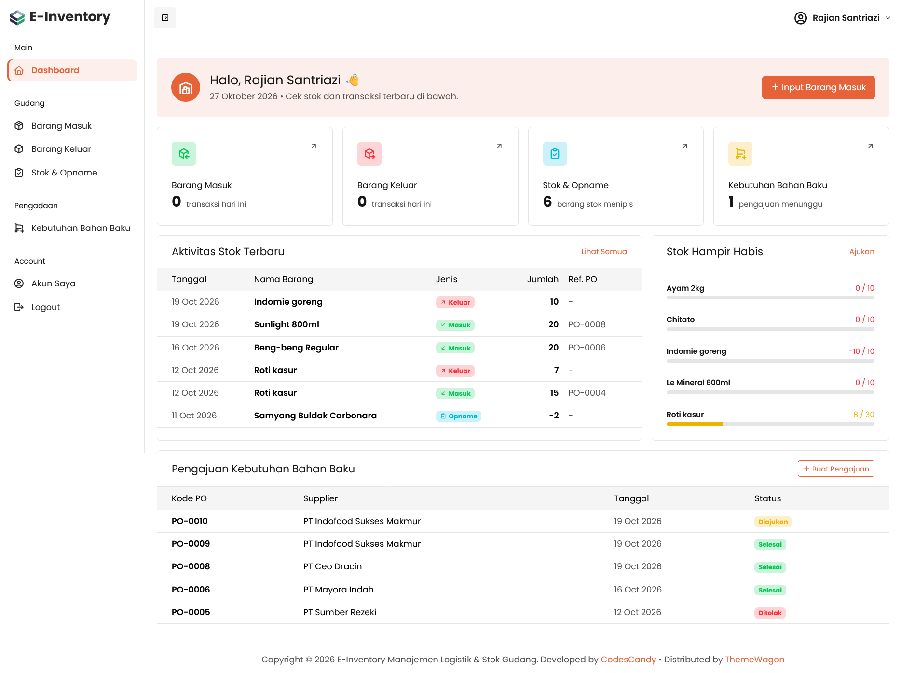
https://inventory.rinjaniproject.my.id/e-inventory/petugas/index.php?page=tambah-barang-masuk
https://inventory.rinjaniproject.my.id/e-inventory/petugas/index.php?page=barang-masuk
https://inventory.rinjaniproject.my.id/e-inventory/petugas/index.php?page=barang-keluar
https://inventory.rinjaniproject.my.id/e-inventory/petugas/index.php?page=stok
https://inventory.rinjaniproject.my.id/e-inventory/petugas/index.php?page=kebutuhan-bahan-baku
https://inventory.rinjaniproject.my.id/e-inventory/petugas/index.php?page=stok
https://inventory.rinjaniproject.my.id/e-inventory/petugas/index.php?page=tambah-kebutuhan-bahan-baku
https://inventory.rinjaniproject.my.id/e-inventory/petugas/index.php?page=tambah-kebutuhan-bahan-baku

### B. https://inventory.rinjaniproject.my.id/e-inventory/petugas/index.php?page=barang-masuk
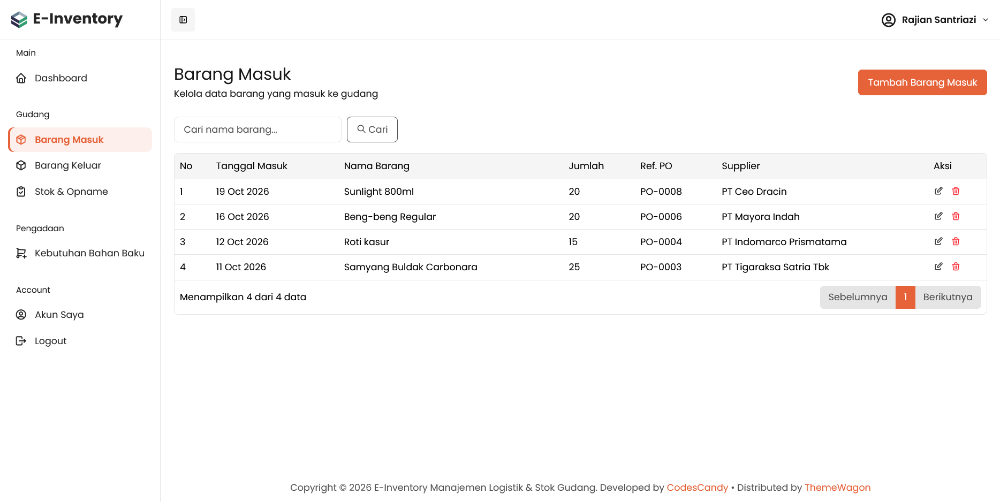
https://inventory.rinjaniproject.my.id/e-inventory/petugas/index.php?page=tambah-barang-masuk
https://inventory.rinjaniproject.my.id/e-inventory/petugas/index.php?page=edit-barang-masuk&id=25
https://inventory.rinjaniproject.my.id/e-inventory/petugas/function/barang-masuk.php?aksi=hapus&id=25
#### b. https://inventory.rinjaniproject.my.id/e-inventory/petugas/index.php?page=tambah-barang-masuk
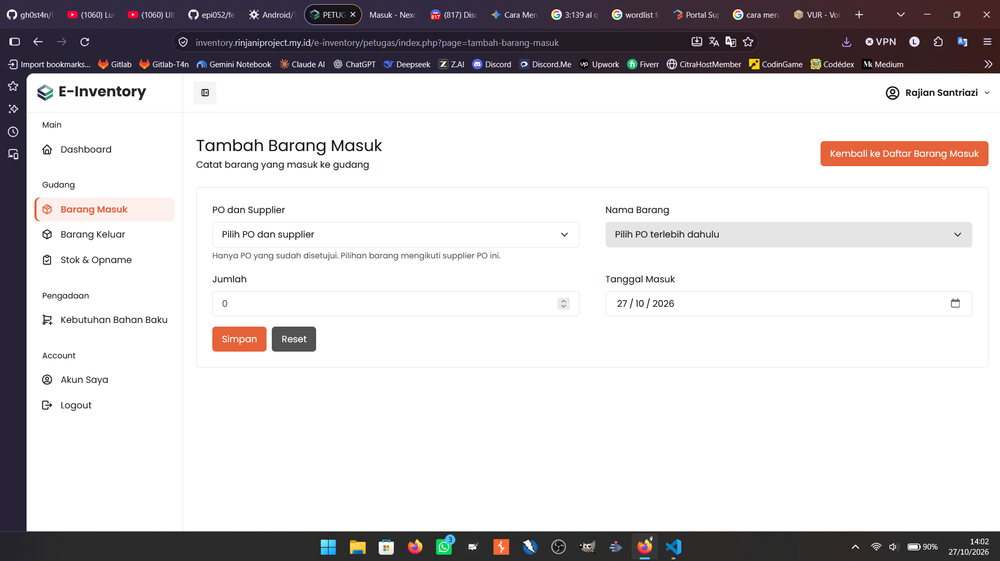

### C. https://inventory.rinjaniproject.my.id/e-inventory/petugas/index.php?page=barang-keluar
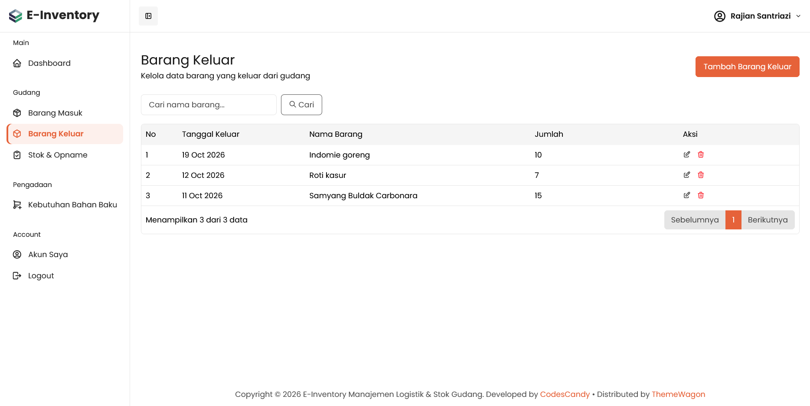
https://inventory.rinjaniproject.my.id/e-inventory/petugas/index.php?page=edit-barang-keluar&id=27
https://inventory.rinjaniproject.my.id/e-inventory/petugas/function/barang-keluar.php?aksi=hapus&id=27
#### c. https://inventory.rinjaniproject.my.id/e-inventory/petugas/index.php?page=tambah-barang-keluar
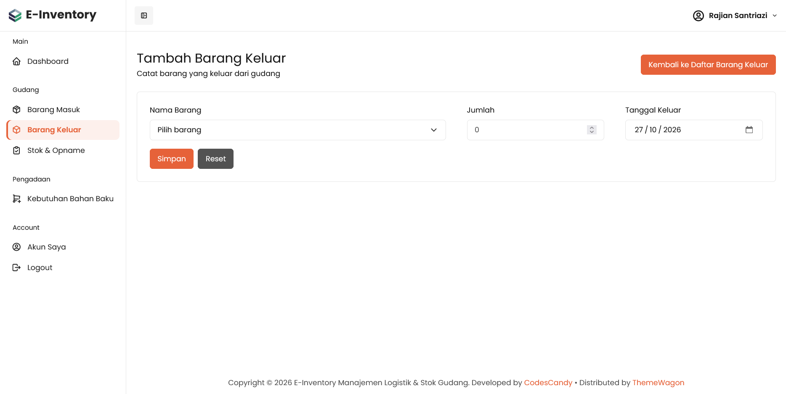

### D, https://inventory.rinjaniproject.my.id/e-inventory/petugas/index.php?page=stok
https://inventory.rinjaniproject.my.id/e-inventory/petugas/index.php?page=tambah-opname&product_id=7
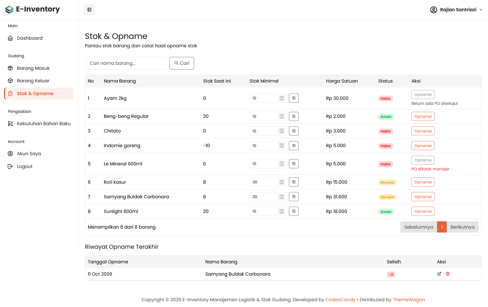
#### d. https://inventory.rinjaniproject.my.id/e-inventory/petugas/index.php?page=tambah-opname&product_id=7
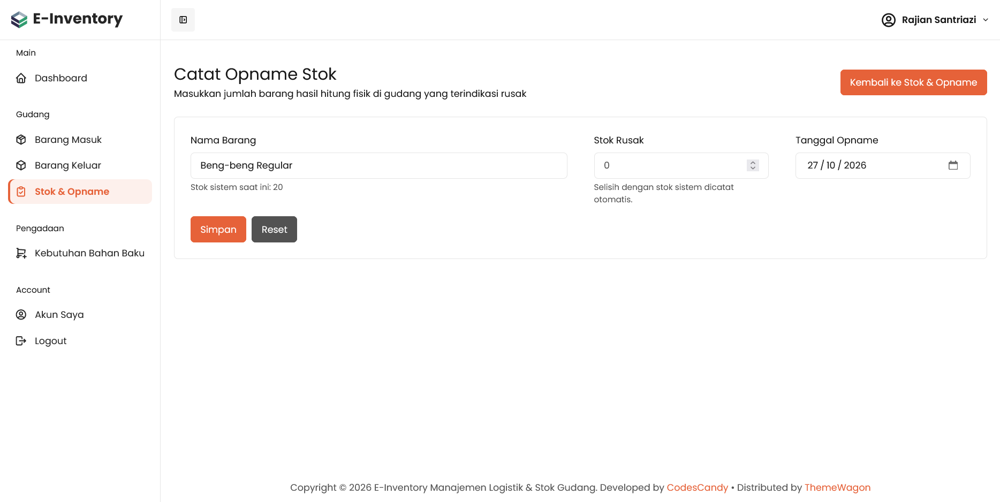

### E. https://inventory.rinjaniproject.my.id/e-inventory/petugas/index.php?page=kebutuhan-bahan-baku
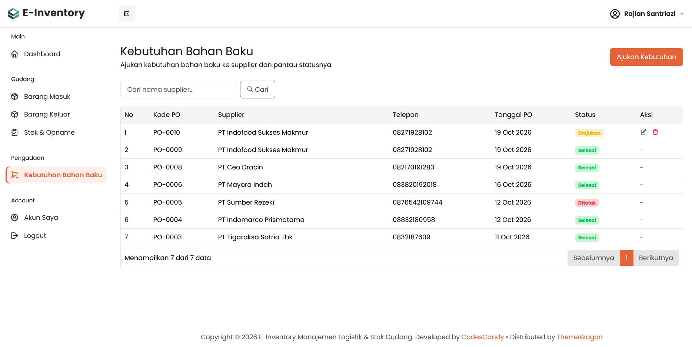
https://inventory.rinjaniproject.my.id/e-inventory/petugas/index.php?page=tambah-kebutuhan-bahan-baku
https://inventory.rinjaniproject.my.id/e-inventory/petugas/index.php?page=edit-kebutuhan-bahan-baku&id=10
https://inventory.rinjaniproject.my.id/e-inventory/petugas/function/kebutuhan-bahan-baku.php?aksi=hapus&id=10

#### e. https://inventory.rinjaniproject.my.id/e-inventory/petugas/index.php?page=edit-kebutuhan-bahan-baku&id=10
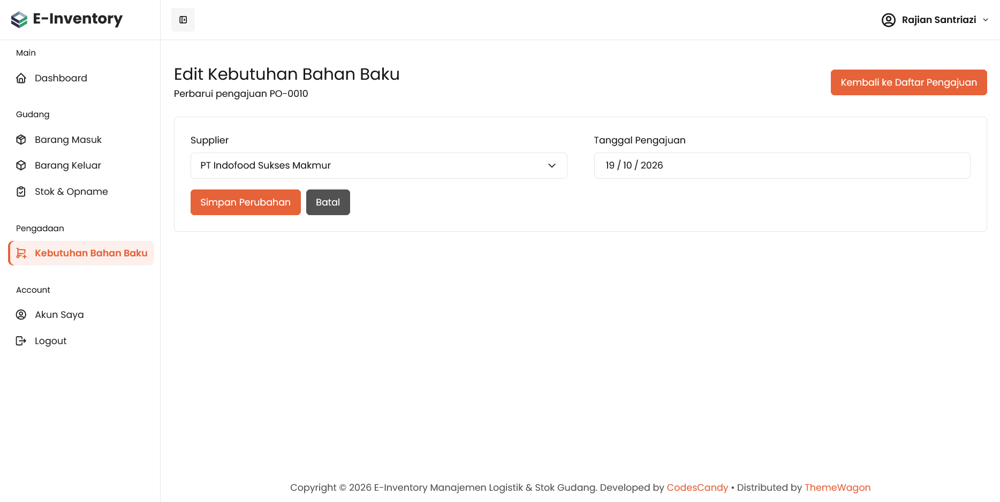

### F. https://inventory.rinjaniproject.my.id/e-inventory/petugas/index.php?page=akun
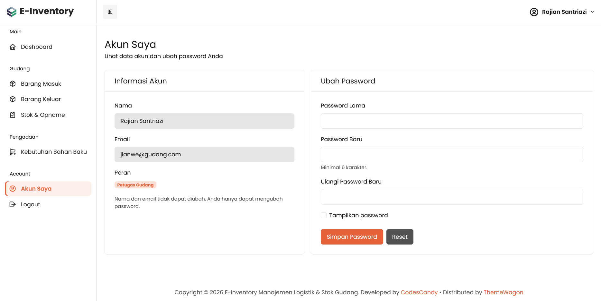

## Manajer
https://inventory.rinjaniproject.my.id/e-inventory/manajer/login/login.php

https://inventory.rinjaniproject.my.id/e-inventory/manajer/index.php?page=dashboard
https://inventory.rinjaniproject.my.id/e-inventory/manajer/index.php?page=verifikasi-po
https://inventory.rinjaniproject.my.id/e-inventory/manajer/index.php?page=petugas-gudang
https://inventory.rinjaniproject.my.id/e-inventory/manajer/index.php?page=laporan-stok
https://inventory.rinjaniproject.my.id/e-inventory/manajer/index.php?page=riwayat-transaksi
https://inventory.rinjaniproject.my.id/e-inventory/manajer/login/logout.php

### https://inventory.rinjaniproject.my.id/e-inventory/manajer/index.php?page=dashboard
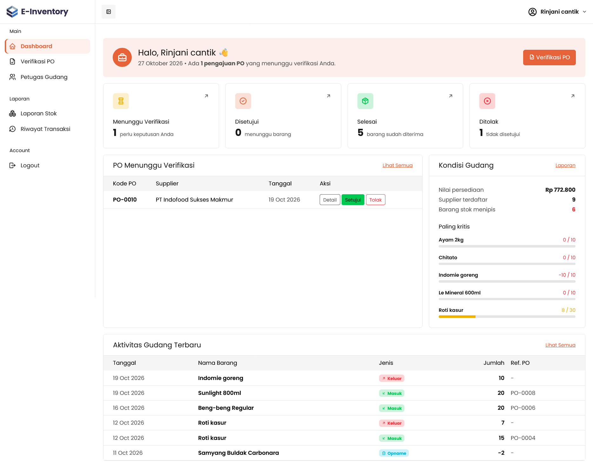
https://inventory.rinjaniproject.my.id/e-inventory/manajer/index.php?page=verifikasi-po&status=diajukan
https://inventory.rinjaniproject.my.id/e-inventory/manajer/index.php?page=verifikasi-po&status=diajukan
https://inventory.rinjaniproject.my.id/e-inventory/manajer/index.php?page=verifikasi-po&status=selesai
https://inventory.rinjaniproject.my.id/e-inventory/manajer/index.php?page=verifikasi-po&status=ditolak

https://inventory.rinjaniproject.my.id/e-inventory/manajer/index.php?page=detail-po&id=10

-PO Menunggu Verifikasi
https://inventory.rinjaniproject.my.id/e-inventory/manajer/index.php?page=detail-po&id=10

https://inventory.rinjaniproject.my.id/e-inventory/manajer/index.php?page=laporan-stok
https://inventory.rinjaniproject.my.id/e-inventory/manajer/index.php?page=riwayat-transaksi

### https://inventory.rinjaniproject.my.id/e-inventory/manajer/index.php?page=verifikasi-po
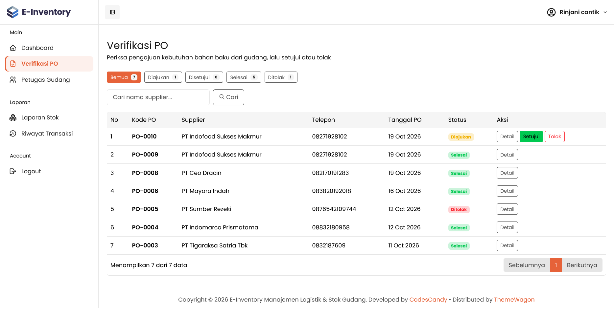
https://inventory.rinjaniproject.my.id/e-inventory/manajer/index.php?page=detail-po&id=10&status=diajukan&cari=&halaman=1

### https://inventory.rinjaniproject.my.id/e-inventory/manajer/index.php?page=petugas-gudang
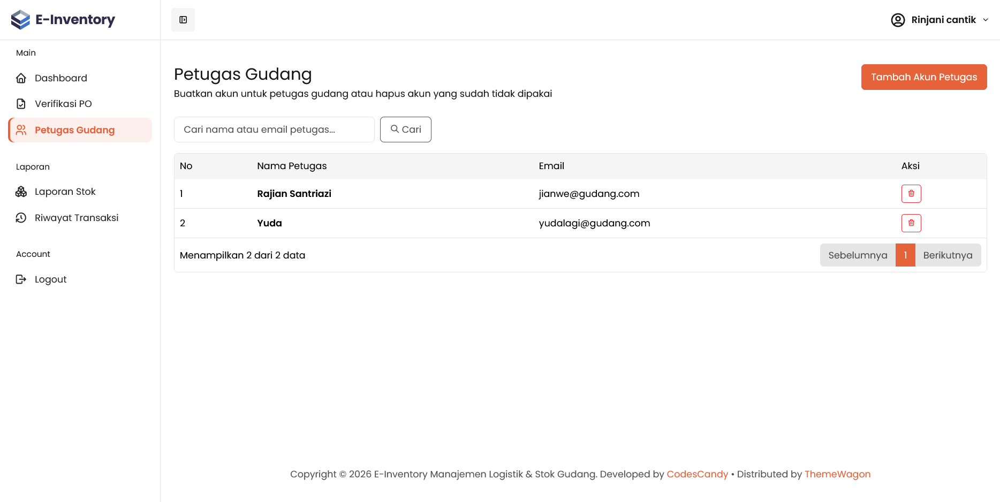
https://inventory.rinjaniproject.my.id/e-inventory/manajer/index.php?page=tambah-petugas-gudang
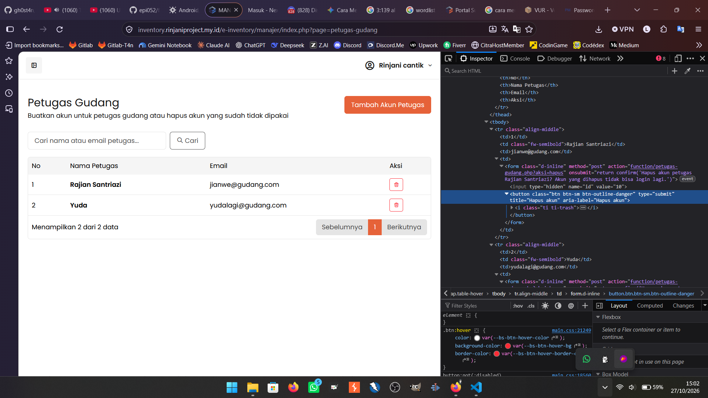

### https://inventory.rinjaniproject.my.id/e-inventory/manajer/index.php?page=laporan-stok
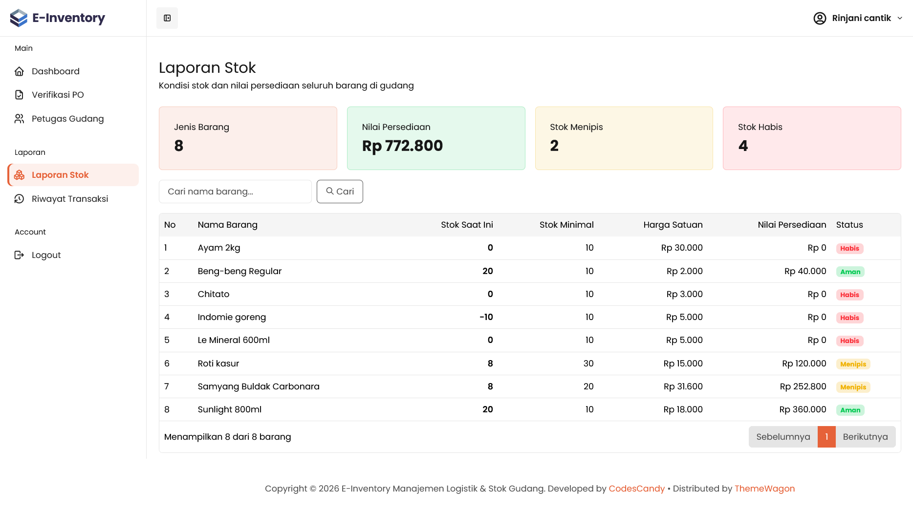

### https://inventory.rinjaniproject.my.id/e-inventory/manajer/index.php?page=riwayat-transaksi
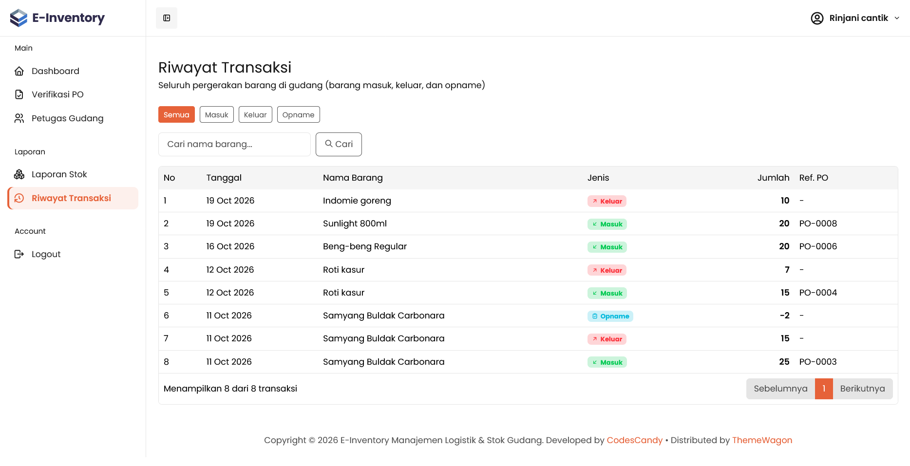
https://inventory.rinjaniproject.my.id/e-inventory/manajer/index.php?page=riwayat-transaksi&jenis=masuk&cari=
https://inventory.rinjaniproject.my.id/e-inventory/manajer/index.php?page=riwayat-transaksi&jenis=keluar&cari=
https://inventory.rinjaniproject.my.id/e-inventory/manajer/index.php?page=riwayat-transaksi&jenis=opname&cari=